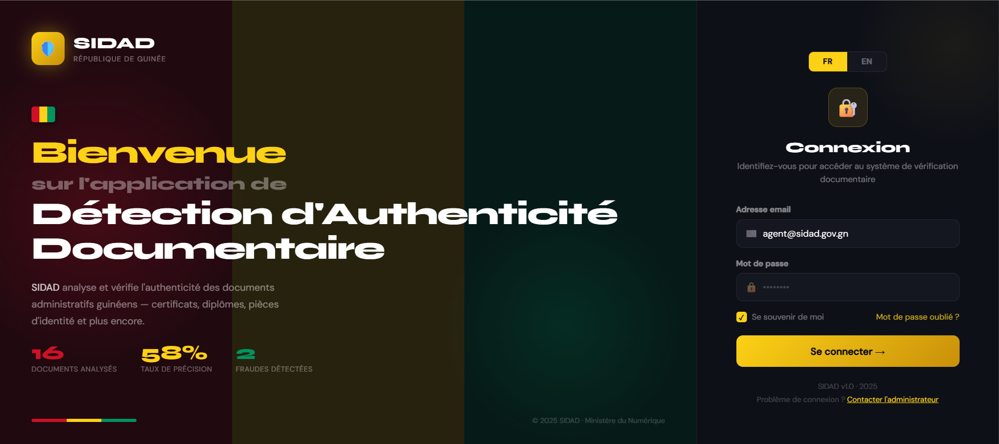
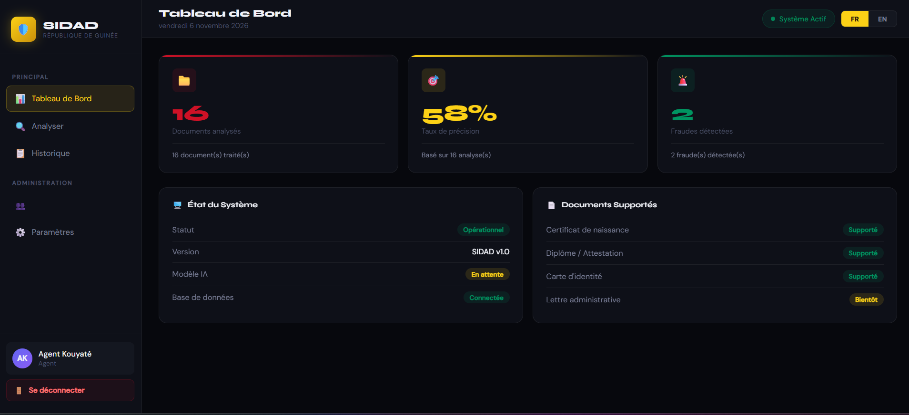
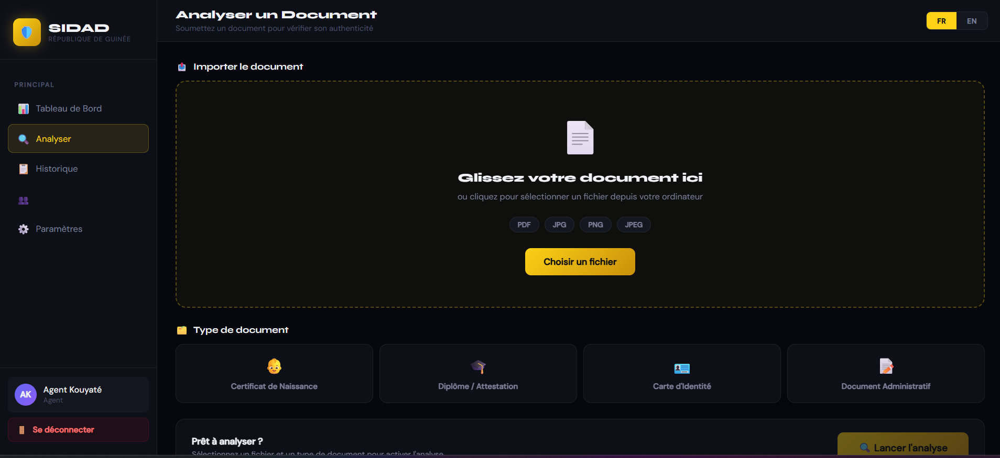
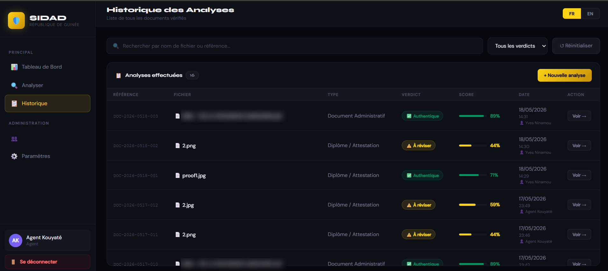

# SIDAD – Intelligent System for Detecting Forged Digital Administrative Documents

**SIDAD** (*Système Intelligent de Détection d'Authenticité Documentaire*) is a web-based prototype that screens scanned administrative documents (diplomas, birth certificates, identity cards) for signs of forgery using classical image-forensics techniques, with no deep learning required.

It was built as my Final Year Project for the **Bachelor of Computer Science (Honours)** at **Universiti Geomatika Malaysia** (2026). The project was motivated by document fraud in Guinea and other West African countries.

> ⚠️ **Research prototype.** SIDAD is a decision-support tool. Every verdict should be confirmed by a person. See [Evaluation & limitations](#evaluation--limitations).

---

## ✨ Features

- **4 forensic techniques** combined into one weighted authenticity score:
  | Technique | Weight | What it detects |
  |---|---|---|
  | Error Level Analysis (ELA) | 50% | Regions re-compressed differently after editing |
  | Noise inconsistency | 20% | Areas whose noise pattern differs from the rest of the image |
  | Double JPEG compression | 15% | Traces of an image being saved more than once |
  | EXIF metadata | 15% | Editing-software tags and missing camera data |
- **3-level verdict**: ✅ Authentic (≥ 65%) · ⚠️ Manual review (40–64%) · ❌ Forged (< 40%)
- **Supports** JPEG, PNG and PDF files (PDF pages are rendered at 150 DPI)
- **Downloadable PDF forensic report** for each analysis
- **Dashboard** showing total analyses, average score, number of forgeries and fraud rate
- **Analysis history**, with filters and a unique reference for each analysis (`DOC-YYYY-MMDD-NNN`)
- **Bilingual interface** in French and English, built for non-specialist administrative staff
- **Fast and lightweight**: under 1 second per image on ordinary hardware

## 🛠️ Tech stack

| Layer | Technology |
|---|---|
| Backend | Python, Flask, Flask-CORS |
| Image processing | Pillow, NumPy, PyMuPDF |
| Reports | ReportLab |
| Database | SQLite |
| Frontend | HTML5, CSS3, JavaScript (ES6) |

## 🏗️ Architecture

```
Browser (7 HTML pages)  ──HTTP/JSON──▶  Flask REST API (app.py)  ──▶  Forensic engine (ela.py)
                                              │
                                              ▼
                                       SQLite (analyses table)
```

### REST API

| Method | Endpoint | Description |
|---|---|---|
| `POST` | `/analyser` | Upload a document, run the forensic analysis and return the scores as JSON |
| `POST` | `/sauvegarder` | Save an analysis result with a unique reference number |
| `GET` | `/historique` | List all stored analyses |
| `GET` | `/stats` | Return dashboard statistics (totals, mean score, fraud rate) |
| `POST` | `/rapport` | Generate a downloadable PDF forensic report |

### Interface pages
`index.html` (login) · `dashboard.html` · `analyser.html` · `resultat.html` · `historique.html` · `utilisateurs.html` · `parametres.html`

## 🚀 Getting started

```bash
git clone https://github.com/ninamoumagloire-beep/sidad.git
cd sidad
pip install -r requirements.txt
python app.py
```

Then open **http://127.0.0.1:5000** in your browser.
On Windows, you can also double-click `LANCER_SIDAD.bat` to start the server.
The SQLite database (`sidad.db`) is created automatically on first launch.

### Demo accounts

| Role | Email | Password |
|---|---|---|
| Super administrator | `admin@sidad.gov.gn` | `admin123` |
| Agent | `agent@sidad.gov.gn` | `agent123` |

> These accounts are for demonstration only. In this prototype, login is checked in the browser. A production version would need server-side authentication with hashed passwords (see the roadmap).

## 📁 Project structure

```
sidad/
├── app.py              # Flask REST API + SQLite initialisation
├── ela.py              # Forensic analysis engine (ELA, noise, double compression, EXIF)
├── requirements.txt
├── LANCER_SIDAD.bat    # Windows launcher
├── index.html          # Login
├── dashboard.html      # Statistics dashboard
├── analyser.html       # Document upload & analysis
├── resultat.html       # Analysis result
├── historique.html     # Analysis history
├── utilisateurs.html   # User management
├── parametres.html     # Settings
└── 404.html
```

## 📊 Evaluation & limitations

SIDAD was evaluated in three ways:

1. **Functional test** with 10 real administrative documents (16 analyses). This confirmed that the full workflow runs from start to finish and that repeated analyses give the same results.
2. **Controlled experiment** with 40 synthetic documents (20 authentic, 20 forged), measured with a confusion matrix, precision, recall, F1-score and ROC AUC.
3. **Ablation study and 5-fold cross-validated weight search**, which measured how much each technique contributes.

**Key findings**
- When "manual review" verdicts count as flags, **every forged document was flagged (100% recall)**. However, many authentic documents were also sent for review.
- **ELA alone ranked every forged document above every authentic one (AUC = 1.0)**, which makes it the most reliable technique.
- The noise measure saturated, and the double-compression test was inversely related to forgery. Both need to be redesigned.

**Roadmap**
- [ ] Build a labelled dataset of real Guinean documents and recalibrate the scoring weights
- [ ] Fix the noise and double-compression components
- [ ] Add OCR (Tesseract) and content verification
- [ ] Train a deep learning model once enough labelled data is available
- [ ] Move authentication to the server, with hashed passwords
- [ ] Build a mobile app and add cryptographic QR codes for new documents

## 📸 Screenshots

| Login | Dashboard |
|---|---|
|  |  |
| **Document analysis** | **Analysis history** |
|  |  |

_Personal file names in the history screenshot have been blurred for privacy._

## 👤 Author

**Yves Guenelo Ninamou** – Computer Science (Honours) graduate
[LinkedIn](https://www.linkedin.com/in/yves-guenelo-ninamou-744a182a6) · yvesninamou@outlook.com
